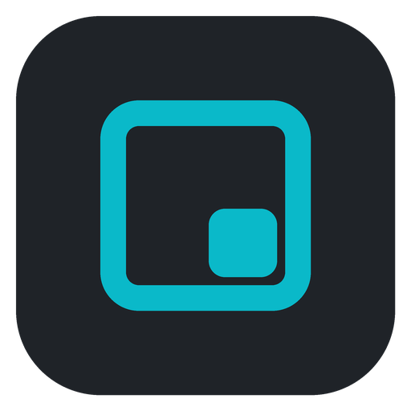

<div align="center">



# SquareDeck

**A controller-first game launcher for Windows handhelds and living-room PCs.**

Your games from every store, your apps, music and settings on one console-style home screen
you can drive entirely with a gamepad.

[Download](https://github.com/tetraguy/SquareDeck/releases) · [Changelog](CHANGELOG.md) · [Report a problem](https://github.com/tetraguy/SquareDeck/issues)

</div>

<!-- Add screenshots here, for example:
<p align="center">
   
</p>
-->

## Why SquareDeck


Windows on a handheld means a desktop built for a mouse, and a different launcher for every store. SquareDeck puts
one home screen in front of all of it: pick it up, press A, play.

- **One library.** Steam, Epic, GOG, Xbox / Game Pass, Battle.net, Ubisoft Connect and the EA app, plus your own
  programs and apps. Covers, hero art and logos come from SteamGridDB.
- **Built for a controller.** Every page, setting and pop-up works with a gamepad, touch, keyboard or mouse.
- **Made for handhelds.** Power limits (TDP) per game, a quick menu over your game, and it gets out of the game's way
  while you play.
- **Yours to style.** 65 UI styles with matching colors, wallpapers, sounds and music.

## Features

### Library and games
- Home row of recent games, favorites, collections, categories, ratings, status and notes
- Game pages with details, achievements, screenshots, trailers and play time, for every game (details for non-Steam
  games come from the Steam store when the game is sold there, or Wikipedia)
- Pick any game's square cover, tall grid, hero image and logo from SteamGridDB, or use your own
- Library views: Square (the cover as it is), Grid (tall poster art) or Rectangle (the wide store header), in six
  layouts: Sidebar, Compact, Large tiles, List, Shelves and Spotlight
- Launch splash that covers store pop-ups until the game is on screen, with an optional countdown
- Start Steam games straight from their .exe to skip Steam's launch pop-up
- Asks before starting a Steam game with an update waiting: update first (with live progress) or play anyway
- Stop a game from the launcher, with a console-style "Closing software" screen
- Session summaries, play-time tracking and achievement pop-ups
- **Cloud gaming:** Xbox Cloud Gaming, GeForce NOW, Amazon Luna and Antstream Arcade on the Stores page, full screen
  with your controller passed straight to the game. Leave with View + Start (hold), Ctrl+Shift+Q, or the hidden corner button

### Handheld
- **TDP control** for AMD handhelds through RyzenAdj, with per-game limits for battery and plugged in
- Live processor, memory, graphics, storage and network readouts in Settings > Power and performance
- **Performance Boost:** frees memory before a game starts, with ten animations and matching vibration
- **Performance overlay:** FPS, frame time, CPU / GPU use, CPU speed, RAM, TDP and battery over your games, in three
  layouts, three detail levels and six styles (FPS through the bundled [PresentMon](https://github.com/GameTechDev/PresentMon))
- **Game profiles:** resolution, refresh rate, HDR, power plan and audio device, applied on launch and put back after
- **In-game quick menu** over any full-screen game (Xbox mode too): live CPU / GPU / RAM use, screenshot and record,
  volume, brightness, TDP and exit
- **Xbox mode home app:** boot straight into SquareDeck on Windows 11's full screen experience, no extra tool needed
- **ROG Ally buttons:** remap Armoury Crate, Command Center and the back-button combos
- Lean mode while a game runs: lets go of covers, pages and caches, frees graphics memory and lets Windows reclaim
  its memory first, then comes back with focus when the game closes
- Rests while another app is in front: music, moving backgrounds and animated covers pause
- Performance mode, low-battery notice and Do not disturb while playing

### Look and feel
- 65 UI styles across five layouts: classic row, hero, top row, sidebar and stage
- Pixel-art, frosted glass, Frutiger Aero, OLED black, console-inspired and themed styles
- 24 moving backgrounds (or add your own videos), 11 picture wallpapers, 11 music tracks and 7 interface sound packs
- Controller button pictures for Xbox, PlayStation and Switch, in two art styles, plus keyboard keys
- Light, dark, OLED and high-contrast themes, larger text and reduced motion
- 16 startup animations, and a "Good morning" greeting by your profile picture

### Built in
- Web browser with tabs, favorites and controller navigation
- Multimedia page: music player for your own files, Spotify playing inside the launcher (Premium), now-playing from any app, and Netflix, YouTube, Hulu,
  Prime Video, Crunchyroll, Disney+, Paramount+ and Tubi full screen with controller controls (each locked to its own site)
- Captures gallery for Game Bar screenshots and clips, grouped by game, with a built-in share sheet
- File explorer, task manager, Wi-Fi, Bluetooth, display and sound settings
- Terminal (Command Prompt or PowerShell) inside the launcher, and a storage speed test for drives and memory cards
- Steam friends, game news, search across everything
- Backup and restore of settings and library
- Apps in Settings: see every installed app, and uninstall, modify, repair or reset it

### Some of the Many Available UI Styles

## Pop Art


## Retro


## Aurora


## Pixel Dawn


## Pixel City


### Built-in Solutions

## File Explorer


## Music Player


## Web Browser


## Task Manager


### Some of the Many Available UI Styles

## Pop Art


## Retro


## Aurora


## Pixel Dawn


## Pixel City


### Built-in Solutions

## File Explorer


## Music Player


## Web Browser


## Task Manager


## Install

1. Download the latest release from the [Releases page](https://github.com/tetraguy/SquareDeck/releases).
**Requirements**

| | |
|---|---|
| Windows | 10 version 2004 or newer. Windows 11 24H2 for Xbox mode. |
| Runtime | [.NET 8 Desktop Runtime](https://dotnet.microsoft.com/download/dotnet/8.0) |
| Browser | WebView2 Runtime (included with Windows 11 and current Windows 10) |
| TDP control | An AMD Ryzen handheld. Setup asks for administrator permission once. |

## Controls

| Action | Controller | Keyboard |
|---|---|---|
| Move | D-pad / left stick | Arrow keys |
| Start game / select | A | Enter |
| Back | B | Esc |
| Game details | X | X |
| Game options | Y | Y |
| Next / previous page | RB / LB | Page Down / Page Up |
| Jump by letter (library) | RT / LT | |
| Scroll a long page | Right stick | Mouse wheel |
| Search everything | Start / Menu | F3 or / |
| Quick settings | View | Q |
| In-game quick menu | Guide, or View + Start | |
| Windowed / full screen | | F11 |

A, B, X and Y can be swapped (there's a Nintendo-layout preset), and you choose which pages LB / RB switch
between, in Settings > Controller and quick menu.

## Set as the Xbox mode home app

On Windows 11 24H2 or later, SquareDeck can be what Xbox mode (the gaming full screen experience) opens to.

1. Turn on Developer Mode in Windows: Settings > System > For developers.
2. In SquareDeck: Settings > System and tools > Xbox mode home app > **Use SquareDeck as the Xbox mode home app**.
3. Optionally turn on **Open Xbox mode when Windows starts**.

SquareDeck registers its own folder with Windows; nothing is installed elsewhere. Developer Mode is needed because
Windows only accepts home apps from outside the Microsoft Store that way. [AnyFSE](https://github.com/ashpynov/AnyFSE)
remains available from the same page if you prefer it.

## Build from source

```
git clone https://github.com/tetraguy/SquareDeck.git
cd SquareDeck
dotnet run --project SquareDeck
```

Or open `SquareDeck.sln` in Visual Studio 2022 with the ".NET desktop development" workload and press F5.
The first build downloads one NuGet package (Microsoft.Web.WebView2).

SquareDeck is a WPF app on .NET 8. Settings, covers and your library edits live in `%LOCALAPPDATA%\SquareDeck`.

## Good to know

- **Stopping a game** ends every program running from its install folder. Unsaved progress is lost.
- **Achievements** and friends need your Steam profile's game details to be public, and a free Steam Web API key
  for some features.
- **The in-game quick menu** and **performance overlay** are windows over the game. They can't appear over exclusive-fullscreen games; borderless works.
- **Cloud gaming** services need their own accounts and subscriptions, and run in SquareDeck's built-in Edge (WebView2).
- **Play time** is counted only while SquareDeck is open.
- **Starting Steam games directly** skips launch options set in Steam, may hide the Steam overlay, and some games
  still restart through Steam.
- **A backup file contains your API keys.** Keep it private.
- **Replace the Windows desktop** makes SquareDeck your shell. If it ever fails to open: Ctrl+Shift+Esc > Run new
  task > `explorer.exe`, then turn the setting off.

More notes on individual features are in the [changelog](CHANGELOG.md).


## Credits

- Artwork from [SteamGridDB](https://www.steamgriddb.com/)
- FPS in the performance overlay uses [PresentMon](https://github.com/GameTechDev/PresentMon) (MIT), bundled in `SquareDeck/Tools/PresentMon`
- TDP control uses [RyzenAdj](https://github.com/FlyGoat/RyzenAdj) (LGPL-3.0), bundled in `SquareDeck/Tools/RyzenAdj`
- ROG Ally button reading is based on [AnyFSE](https://github.com/ashpynov/AnyFSE) by Artem Shpynov (MIT)
- Sound packs, music, moving backgrounds and controller glyphs belong to their respective creators

SquareDeck is an independent project. It isn't affiliated with or endorsed by Valve, Microsoft, Nintendo, Sony,
ASUS or any store or publisher named here. All trademarks belong to their owners.
